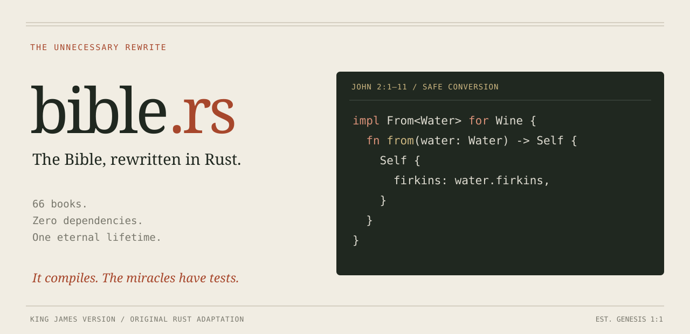
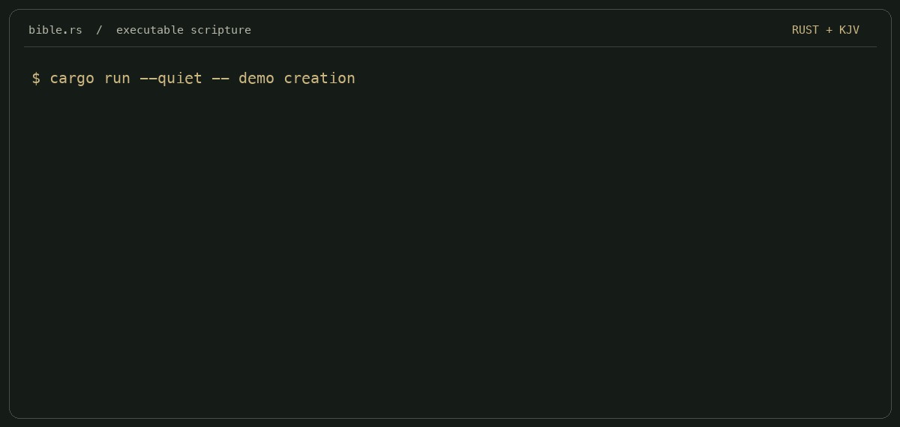

<p align="center">
  
</p>

<p align="center">
  <a href="https://github.com/matthewpeak/bible.rs/actions/workflows/ci.yml"></a>
  
  
  
  <a href="LICENSE"></a>
</p>

Someone said Rust developers would rewrite the Bible if you let them.

This was interpreted as a feature request.

```rust
impl From<Water> for Wine {
    fn from(water: Water) -> Self {
        Self { firkins: water.firkins }
    }
}
```

**It compiles. The miracles have tests.**

All 66 books have their own Rust module: 600 selected scenes, eight executable
showcases, and a small CLI. Direct quotations are **King James Version**.
Narrative events update state. Laws, prayers, wisdom, prophecies, and letters have
their own types. Coverage is at the story and teaching level, with longer passages
condensed. [Read the source and modeling notes.](SOURCES.md)

## Run it

Requires [Rust 1.85 or newer](https://www.rust-lang.org/tools/install).

```sh
git clone https://github.com/matthewpeak/bible.rs.git
cd bible.rs
cargo run -- genesis
```

```sh
cargo run -- demo              # The eight scenes that needed a compiler.
cargo run -- demo cana         # A conversion trait with unusual behaviour.
cargo run -- all               # Execute every book, print a compact ledger.
cargo run -- all --full        # Every adapted scene. Bring a scroll wheel.
cargo run -- list              # The complete canon.
cargo run -- 1-samuel          # Numbered books work too.
cargo run -- source john       # Read the actual Rust, right in your terminal.
cargo run -- check             # Check references and replay every account.
cargo test                    # Including examples that must fail to compile.
```

No crates to download. No API key. No network calls at runtime.
To install the CLI locally, run `cargo install --path . --locked`, then `bible demo`.

## A few implementation decisions

| Passage | Implementation | Source |
|---|---|---|
| Creation | Light arrives three days before the sun. Day seven adds no creation changes. | [Genesis](src/books/genesis.rs) |
| The Fall | Eve eats, then moves the remaining fruit to Adam. The borrow checker permits disobedience. | [Genesis](src/books/genesis.rs) |
| Noah's ark | Clean animals and birds have a different manifest rule. The edge cases are in chapter seven. | [Genesis](src/books/genesis.rs) |
| Babel | Three real threads. One instruction. Suddenly incompatible language protocols. | [Genesis](src/books/genesis.rs) |
| The Red Sea | A mutable borrow keeps the passage open. `Drop` closes it. | [Exodus](src/books/exodus.rs) |
| Cana | `From<Water> for Wine`. Six waterpots. Zero `unsafe`. | [John](src/books/john.rs) |
| Resurrection | `Person<Alive> → Person<Dead> → Person<Alive>`. Each transition consumes the old state. | [John](src/books/john.rs) |
| New creation | `World<Former> → World<Renewed>`. Death and sorrow do not survive the migration. | [Revelation](src/books/revelation.rs) |

The sea really does close at the end of the scope:

```rust
let mut sea = RedSea::default();
{
    let mut passage = sea.part();
    passage.cross("Israel");
} // Drop closes the sea. The people remain on the other side.
```

Try opening a second passage while the first is borrowed and the compiler stops
you. There is a compile-fail test for that. There is also one for reusing the
fruit after moving it, and one for resurrecting someone who is already alive.

## See it run



The animation replays captured CLI output with pauses for reading.
A [static terminal preview](assets/terminal.png) is also available.

## The test suite

```text
light_exists_before_the_sun
the_seventh_day_does_not_mutate_creation
clean_animals_are_not_limited_to_one_pair
the_fruit_moves_and_both_people_eat
the_red_sea_closes_when_the_passage_leaves_scope
cana_preserves_all_six_waterpots_and_their_volumes
resurrection_preserves_identity
the_new_creation_has_no_death_sorrow_sea_or_tears
```

32 integration tests and three compile-fail doctests cover state transitions,
reference bounds, quotation fixtures, command-line failures, and independent
accounts. CI runs on Linux, macOS, and Windows, plus the minimum Rust version.
The crate forbids `unsafe` code.

## Read the books

Start with [Genesis](src/books/genesis.rs), [Exodus](src/books/exodus.rs),
[John](src/books/john.rs), or [Revelation](src/books/revelation.rs) for the showcase
implementations. [The small runtime](src/story.rs) holds the event log and typed
literary forms. [The mechanics](src/miracles.rs) hold the ownership, concurrency,
and state models.

Each book runs independently. The four Gospels are four accounts, so running all
of them does not crucify and resurrect the same mutable variable four times.

<details>
<summary>All 66 modules</summary>

| Old Testament | New Testament |
|---|---|
| [Genesis](src/books/genesis.rs) | [Matthew](src/books/matthew.rs) |
| [Exodus](src/books/exodus.rs) | [Mark](src/books/mark.rs) |
| [Leviticus](src/books/leviticus.rs) | [Luke](src/books/luke.rs) |
| [Numbers](src/books/numbers.rs) | [John](src/books/john.rs) |
| [Deuteronomy](src/books/deuteronomy.rs) | [Acts](src/books/acts.rs) |
| [Joshua](src/books/joshua.rs) | [Romans](src/books/romans.rs) |
| [Judges](src/books/judges.rs) | [1 Corinthians](src/books/first_corinthians.rs) |
| [Ruth](src/books/ruth.rs) | [2 Corinthians](src/books/second_corinthians.rs) |
| [1 Samuel](src/books/first_samuel.rs) | [Galatians](src/books/galatians.rs) |
| [2 Samuel](src/books/second_samuel.rs) | [Ephesians](src/books/ephesians.rs) |
| [1 Kings](src/books/first_kings.rs) | [Philippians](src/books/philippians.rs) |
| [2 Kings](src/books/second_kings.rs) | [Colossians](src/books/colossians.rs) |
| [1 Chronicles](src/books/first_chronicles.rs) | [1 Thessalonians](src/books/first_thessalonians.rs) |
| [2 Chronicles](src/books/second_chronicles.rs) | [2 Thessalonians](src/books/second_thessalonians.rs) |
| [Ezra](src/books/ezra.rs) | [1 Timothy](src/books/first_timothy.rs) |
| [Nehemiah](src/books/nehemiah.rs) | [2 Timothy](src/books/second_timothy.rs) |
| [Esther](src/books/esther.rs) | [Titus](src/books/titus.rs) |
| [Job](src/books/job.rs) | [Philemon](src/books/philemon.rs) |
| [Psalms](src/books/psalms.rs) | [Hebrews](src/books/hebrews.rs) |
| [Proverbs](src/books/proverbs.rs) | [James](src/books/james.rs) |
| [Ecclesiastes](src/books/ecclesiastes.rs) | [1 Peter](src/books/first_peter.rs) |
| [Song of Solomon](src/books/song_of_solomon.rs) | [2 Peter](src/books/second_peter.rs) |
| [Isaiah](src/books/isaiah.rs) | [1 John](src/books/first_john.rs) |
| [Jeremiah](src/books/jeremiah.rs) | [2 John](src/books/second_john.rs) |
| [Lamentations](src/books/lamentations.rs) | [3 John](src/books/third_john.rs) |
| [Ezekiel](src/books/ezekiel.rs) | [Jude](src/books/jude.rs) |
| [Daniel](src/books/daniel.rs) | [Revelation](src/books/revelation.rs) |
| [Hosea](src/books/hosea.rs) |  |
| [Joel](src/books/joel.rs) |  |
| [Amos](src/books/amos.rs) |  |
| [Obadiah](src/books/obadiah.rs) |  |
| [Jonah](src/books/jonah.rs) |  |
| [Micah](src/books/micah.rs) |  |
| [Nahum](src/books/nahum.rs) |  |
| [Habakkuk](src/books/habakkuk.rs) |  |
| [Zephaniah](src/books/zephaniah.rs) |  |
| [Haggai](src/books/haggai.rs) |  |
| [Zechariah](src/books/zechariah.rs) |  |
| [Malachi](src/books/malachi.rs) |  |

</details>

## Frequently opened issues

**Why Rust?** The requirements were interpreted very broadly.

**Why no dependencies?** Creation starts from nothing.

**Is it the entire Bible?** Every book is represented. The 600 scenes condense
stories and teachings; this is not a line-by-line translation of every verse.

**Why KJV?** That was the requested translation. The quotes are checked against
an [identified source](SOURCES.md), not reconstructed from memory.

**Does this settle theological disputes?** It has already introduced several
new ones about ownership.

**Can I contribute?** Yes. Keep the reference accurate, the quotation KJV, and
the code runnable. The joke is the rewrite.

[MIT](LICENSE) for the original code, narration, and artwork. Scripture provenance
is documented in [SOURCES.md](SOURCES.md).
